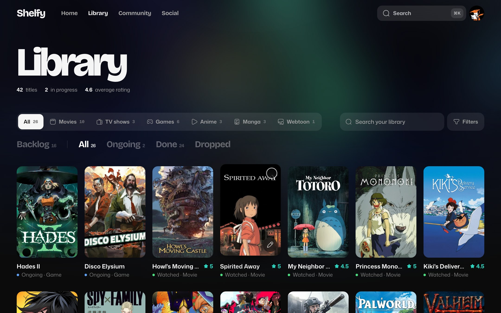
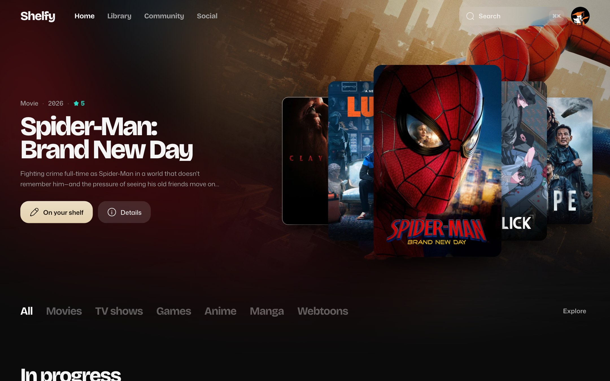
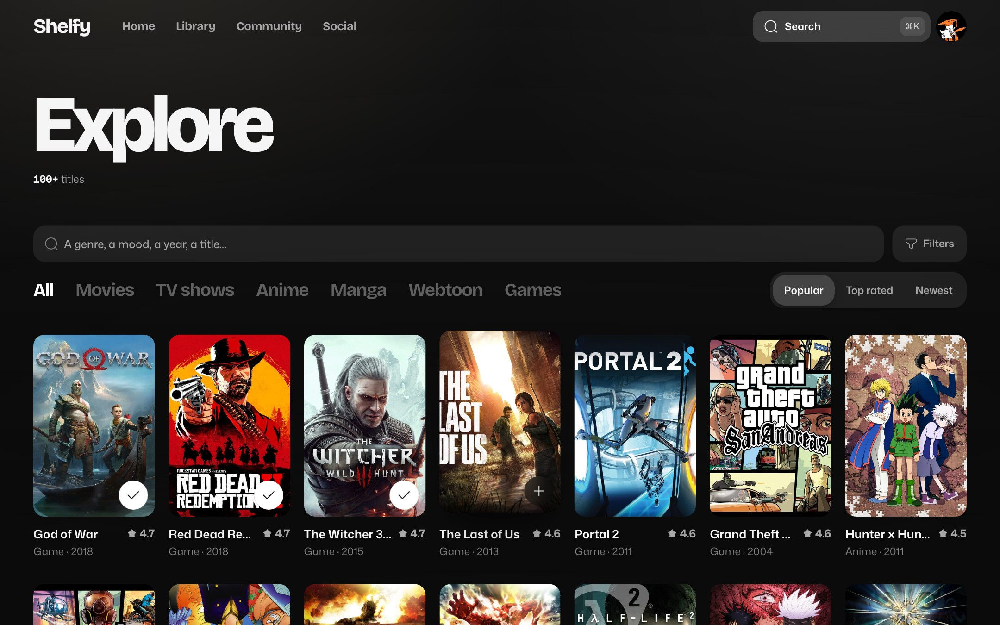
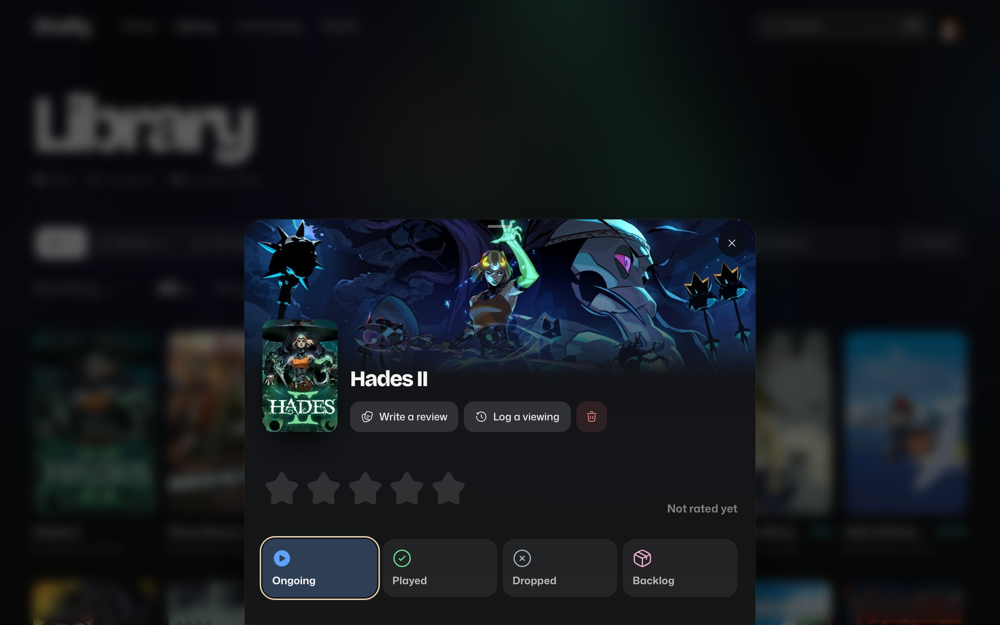
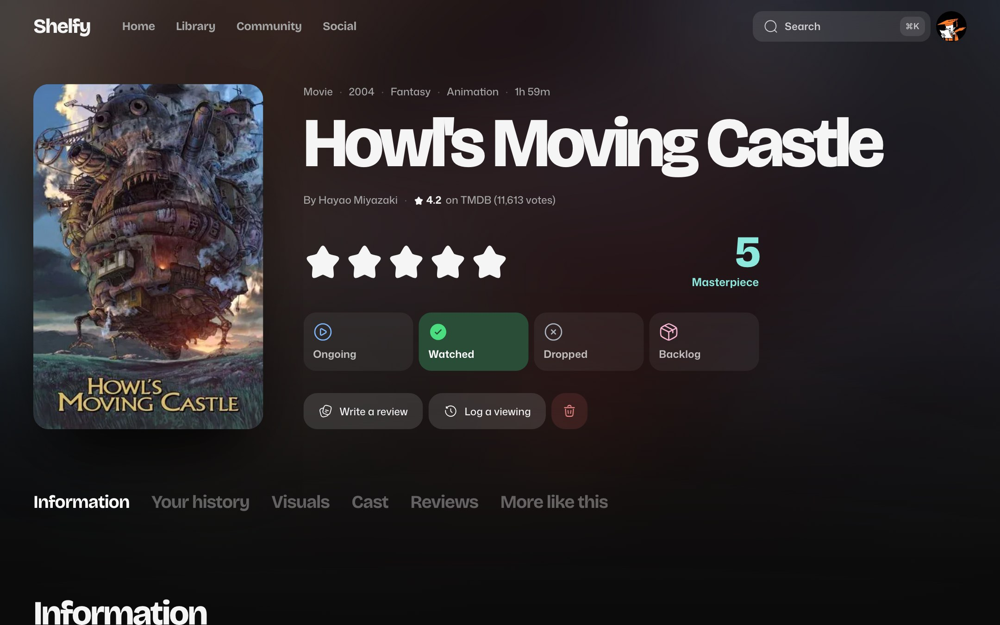
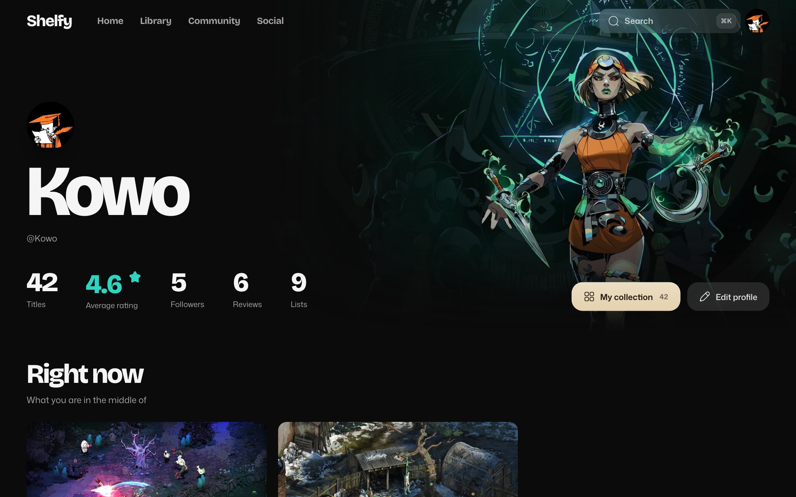
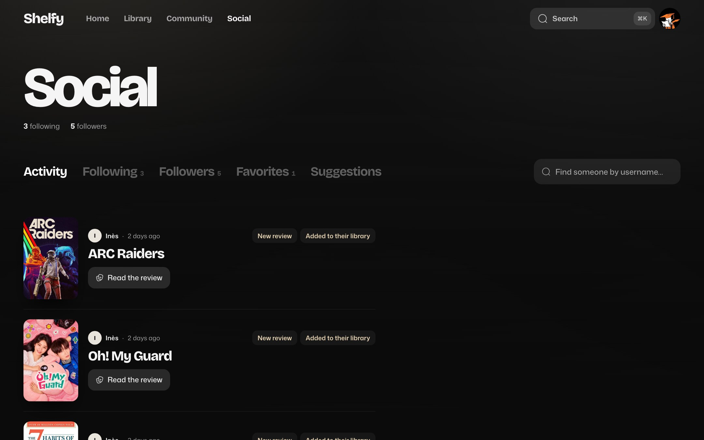

<div align="center">


# Shelfy

One shelf for every story you watch, play and read.

[Try it on shelfy.dev](https://shelfy.dev)

</div>

Shelfy is a self-hosted tracker for films, series, games, anime, manga and webtoons.

It is part of the Fediverse: every instance is independent, yet people on different servers can follow each other, like email addresses.

<p align="center">
  <a href="https://shelfy.dev"></a>
</p>

## Features

- **Track everything** in one place: films, series, games, anime, manga and webtoons, with ratings, reviews and progress.
- **Search** TMDB, IGDB and AniList from a single search bar.
- **Share** lists, reviews and versus pools publicly or only with the people you send the link to.
- **Follow people on other servers**: comment, like and see their shelves in your feed. [How federation works](docs/federation.md)
- **Import** your Letterboxd history and your Steam library.
- **Own your data**: export or delete your account at any time. No analytics, no trackers.

<p align="center">
  
  
</p>

<p align="center">
  
  
</p>

<p align="center">
  
  
</p>

## Self-hosting

Shelfy runs anywhere Docker does: a VPS, a NAS, a Raspberry Pi or an old PC.

You need:

- A machine running Linux, macOS or Windows with WSL2, with at least 2 GB of RAM, since Shelfy builds itself on that machine.
- Docker and Docker Compose 2.24.4 or later (Docker Desktop on macOS and Windows). On Linux, [add your user to the `docker` group](https://docs.docker.com/engine/install/linux-postinstall/) to run the commands without `sudo`.
- An address for your instance: a domain name, or a local IP address for home use.
- An SMTP account to send sign-up and password-reset emails. This one is optional, see below.

### 1. Get the code

On Windows, run every command in a WSL terminal, such as Ubuntu, and clone into the WSL home folder rather than under `/mnt/c`.

```bash
git clone -b stable https://github.com/kowo-dev/Shelfy.git shelfy
cd shelfy
cp docker/.env.example docker/.env
```

The `stable` branch always holds the latest release. `main` is where development happens.

### 2. Fill in `docker/.env`

These values are required. Every other setting is explained in [`docker/.env.example`](docker/.env.example).

| Variable | What to put |
| --- | --- |
| `FRONTEND_DOMAIN` | Your domain (`shelfy.example.com`) or IP address (`192.168.1.20`) |
| `TLS_MODE` | How Shelfy gets HTTPS, see the table below |
| `POSTGRES_PASSWORD` | Any strong password, set before the first start |
| `APP_JWT_ACCESS_TOKEN_SECRET` | A random secret: `openssl rand -base64 48` |
| `SMTP_HOST`, `SMTP_PORT`, `SMTP_USERNAME`, `SMTP_PASSWORD`, `APP_MAIL_FROM` | Your email provider's settings. Set `SMTP_SECURITY=ssl` if it uses port 465 |
| `LEGAL_*` | Who runs and hosts the instance, shown on the legal notice page |

Pick `TLS_MODE` for your setup:

| Your setup | `TLS_MODE` |
| --- | --- |
| 🌍 Public server, with a domain already pointing to it and ports 80 and 443 open | `public`: free Let's Encrypt certificate |
| 🏠 Home network or VPN (Tailscale, WireGuard) | `internal`: self-signed certificate, accept the browser warning once |
| 🔀 Behind your own reverse proxy or tunnel | `off`: also set `FRONTEND_URL` to the `https://` address of your proxy, and `HTTP_BIND=127.0.0.1` if it runs on this machine |

No email server? Set `EMAIL_VERIFICATION_REQUIRED=false` and leave the `SMTP_*` values empty. Accounts work right away, but password resets are not available.

### 3. Start Shelfy

```bash
bash docker/deploy.sh
```

The script checks your configuration, builds and starts everything, then prints the address to open. The first build takes a few minutes. Run it again each time you change `docker/.env`.

### After the first start

**Catalogues.** AniList (anime, manga, webtoons) works out of the box. The others need a free key in `docker/.env`, and stay off while their key is empty:

| Catalogue | Variables | Get a key |
| --- | --- | --- |
| Films and series | `TMDB_ACCESS_TOKEN` | [themoviedb.org](https://www.themoviedb.org/settings/api) |
| Video games | `IGDB_CLIENT_ID`, `IGDB_CLIENT_SECRET` | [dev.twitch.tv](https://dev.twitch.tv/console/apps) |
| Steam library import | `STEAM_API_KEY` | [steamcommunity.com](https://steamcommunity.com/dev/apikey) |

**Federation** is on by default with `TLS_MODE=public`, so your instance can talk to other Shelfy servers and the Fediverse right away. Your domain then becomes part of every username, like `@alice@shelfy.example.com`, so choose it for good. To stay on your own, set `FEDERATION_ENABLED=false` before the first start.

**Sign-ups** are open to anyone by default. For a private instance, create your own account first, then set `REGISTRATION_OPEN=false` and run `deploy.sh` again: the sign-up page closes and its links disappear. To let someone in later, open it the same way for as long as they need.

**Administration.** Put your email in `FEDERATION_ADMINS` to get the administration page, with known and blocked instances and reports from other servers. It only counts once your email is confirmed, either by the link Shelfy emails you or, without an email server, with `bash docker/verify-email.sh you@example.com`.

### Going further

- [Self-hosting guide](docs/self-hosting.md): updates, backups and restore, useful commands, ports, separate API domain, external web hosting.
- [Federation guide](docs/federation.md): how it works for members, instance settings, moderation, administration API.
- [`docker/.env.example`](docker/.env.example): every setting, explained.

## Contributing

Read the [development guide](docs/development.md) to run Shelfy locally, try federation with two instances, and run the checks before opening a pull request.

Found a security issue? Please report it privately, as explained in [SECURITY.md](SECURITY.md).

## License

Shelfy is licensed under the [GNU AGPL v3](LICENSE). If you run a modified version for other people, you must share its source code under the same license.
